# OpenVLA K → G → A 가설 검증 결과 보고서 (실사 이미지)

**프로젝트:** 예픽 — Tracing World Knowledge into Embodied Action in VLA Models
**모델:** OpenVLA-7B (`gen-robot/openvla-7b-rlvla-sft_16k`) · **환경:** SimplerEnv / ManiSkill (Act2Answer 프로토콜)
**작성일:** 2026-10-05 · **본 실험:** 실제 사진 타일 3개 세트, 360 에피소드 (오류 0) · **팀원 실험:** 5개 카테고리(public_info, time_clock, celebrity, living_world, traffic) 3,060 에피소드

---

## 요약

- **행동 결과는 모든 세트에서 같다.** 본 실험(State, Attribute, Emotion)과 팀원 실험 5개 카테고리(public_info, time_clock, celebrity, living_world, traffic) 모두에서 로봇은 지식 질문(Semantic reasoning)과 정답 이름 제시(Explicit object)에서 **우연 수준(약 41~55%)**이고, "왼쪽/오른쪽 타일" 지시(Explicit spatial)에서만 **87~100%** 성공한다.
- **실패는 동작 제어 문제가 아니며, 정답 이름을 알려줘도 해결되지 않는다.** 로봇은 지시 내용보다 **위치(한쪽 타일)**에 따라 고른다. 팀원 데이터에서도 성공률이 정답 위치에 따라 크게 갈린다 (예: public_info 지식 질문 13% ↔ 73%, celebrity 정답 이름 제시 74% ↔ 19%).
- **내부 표현(probe):** 실제 사진에서는 정답(K)이 OpenVLA의 hidden state에서 읽히지 않는다 (State·Attribute는 chance 이하, Emotion은 70~75%지만 chance와 유의한 차이 없음). 따라서 "K는 표현에 있지만 G로 가며 손실된다"는 **가설은 실사 이미지에서 지지되지 않았다.**

**표 1. 판정 요약 (본 실험)**

| 테스트 | 문제 수 | 사전 등록 판정 | Robustness check 판정 | 지식 질문 intent | 위치 제시 intent |
|---|---|---|---|---|---|
| State (사진) | 30 | NO-GO | NO-GO | 50% (30/60) | 80% (48/60) |
| Attribute (사진) | 20 | INCONCLUSIVE (위치 제시 intent 75% < 80%) | INCONCLUSIVE (위치 제시 intent 75% < 80%) | 55% (22/40) | 75% (30/40) |
| Emotion (사진) | 10 | GO | NO-GO | 45% (9/20) | 80% (16/20) |

---

## 1. 무엇을 검증했나

연구제안서의 핵심 가설:

> VLA 내부에 올바른 world-knowledge answer(**K**)가 recoverable하더라도, 이를 visual scene의 physical target(**G**)으로 grounding하는 과정에서 정보가 손실된다. (K → G → A)

과제는 Act2Answer와 같다. 탁자 위에 사진 타일 두 장이 있고, 로봇은 지시문을 읽고 정답 타일 위에 큐브를 올려놓는다. 각 문제는 좌우 배치를 바꾼 버전(noswap / swap)으로 두 번 실행된다.

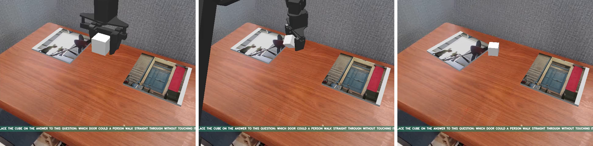
*그림 1. 실제 실행 장면 (시작 · 중간 · 끝). 지시문: "Place the cube on the answer to this question: Which door could a person walk straight through without touching it?" → 로봇이 열린 문(왼쪽) 위에 큐브를 놓음 (성공).*

## 2. 실험 설계

### 2.1 같은 장면, 세 가지 지시문 (matched control)

장면, 타일, 정답 위치, 로봇 초기 상태, seed는 모두 같고 **지시문만** 바꾼다.

| 조건 | 지시문 예시 | 필요한 변환 | 역할 |
|---|---|---|---|
| 지식 질문 (Semantic reasoning) | Place the cube on the answer to this question: Which door keeps the room private? | 지식 → 물체 → 위치 → 행동 | 본 과제 |
| 정답 이름 제시 (Explicit object) | Place the cube on the tile showing the closed door. | 물체 → 위치 → 행동 | 지식 단계 제거 |
| 위치 제시 (Explicit spatial) | Place the cube on the left tile. | 위치 → 행동 | motor floor |

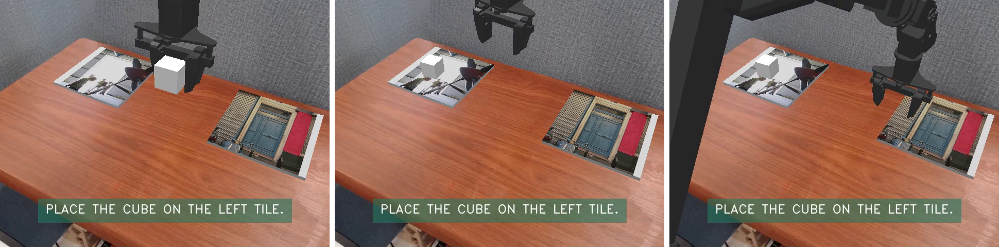
*그림 2. 같은 장면에 "Place the cube on the left tile." 지시 (Explicit spatial).*

### 2.2 측정 지표

| 지표 | 의미 | chance |
|---|---|---|
| Placement success | 큐브가 정답 타일 위에 놓였는가 | 50% |
| Intent (팔이 정답 타일로 갔는가) | 실제 팔 이동 궤적이 정답 타일을 향했는가 | 50% |
| 양쪽 배치 모두 정답 | noswap과 swap 둘 다 맞혀야 1문제 정답. 한쪽만 고르는 로봇은 0% | 25% |
| 왼쪽 선택 비율 | 50%에서 멀수록 내용이 아니라 위치로 고르고 있음 | 50% (편향 없음) |
| **K probe** | hidden state에서 "두 타일 중 어느 것이 정답인지"를 선형 분류기로 읽을 수 있는가 | 50% |
| **G probe** | hidden state에서 "정답이 왼쪽인지 오른쪽인지"를 읽을 수 있는가 | 50% |

Probe는 OpenVLA LLM의 마지막 prompt 토큰 hidden state(첫 추론 시점, 깊이 25/50/75/100%)에 학습하며, **처음 보는 질문 표현**으로만 평가한다 (5-fold, noswap/swap은 같은 fold).

### 2.3 판정 기준 (실행 전에 고정)

레이어 4개를 보므로 유의수준은 Bonferroni 보정 p < 0.0125. 각 세트에 독립적으로 적용한다.

| 기준 | 조건 |
|---|---|
| 1. K 존재 | K(지식 질문) ≥ 65% 이고, chance(50%)보다 유의하게 높음 (이항 검정) |
| 2. G 손실 | 같은 레이어에서 G(지식 질문)의 95% 구간이 50%를 포함 |
| 3. 행동 일치 | 지식 질문 intent의 95% 구간이 50%를 포함하고, 위치 제시 intent ≥ 80% |
| **GO** | 1과 2를 동시에 만족하는 레이어가 있고 3도 만족 |
| INCONCLUSIVE | 위치 제시 intent < 80% (motor floor가 낮아 판정 불가) |

## 3. 데이터셋 (실제 사진)

공식 Act2Answer 에셋은 아직 공개되지 않아(프로젝트 페이지 "Assets (coming soon)") Act2Answer 원본(MLLM-CompBench)과 같은 계열의 공개 사진으로 직접 구성했다. 사진은 **Visual Genome (CC BY 4.0)**, 라벨은 **VAW**(Adobe Research License, 비상업 연구용)에서 가져왔다.

| 세트 | 라벨 쌍 (같은 물체의 반대 상태) | 라벨당 질문 | 문제 수 | 조건당 에피소드 |
|---|---|---|---|---|
| State | open / closed door, clean / dirty toilet, empty / full plate | 5 | 30 | 60 |
| Attribute | wooden / metal bench, glass / plastic bottle | 5 | 20 | 40 |
| Emotion | surprised / sleepy person | 5 | 10 | 20 |

- **정답 노출 방지:** 라벨 A의 j번째 질문은 사진 (A_j, B_j), 라벨 B의 j번째 질문은 (B_j, A_j)를 쓴다. 각 사진 쌍이 두 사진 각각을 정답으로 한 번씩 등장하므로 사진만 보고는 정답을 알 수 없다 (audit 결과 정답 노출 0건). 질문 문장에는 라벨 단어가 들어가지 않는다.
- **사진 선별:** SigLIP(OpenVLA 비전 인코더 계열)이 (1) 두 상태 중 맞는 쪽을 확률 ≥ 0.8로 고르고 (Emotion은 0.6), (2) 해당 물체를 비슷한 물체(냉장고, 쟁반, 고양이 등)보다 높게 골라야 통과. 이후 육안 검토로 6장을 추가 제외했다. 라벨당 5장을 못 채운 쌍(wet/dry road, leather/fabric chair, happy/sad, angry/calm)은 제외됐다.

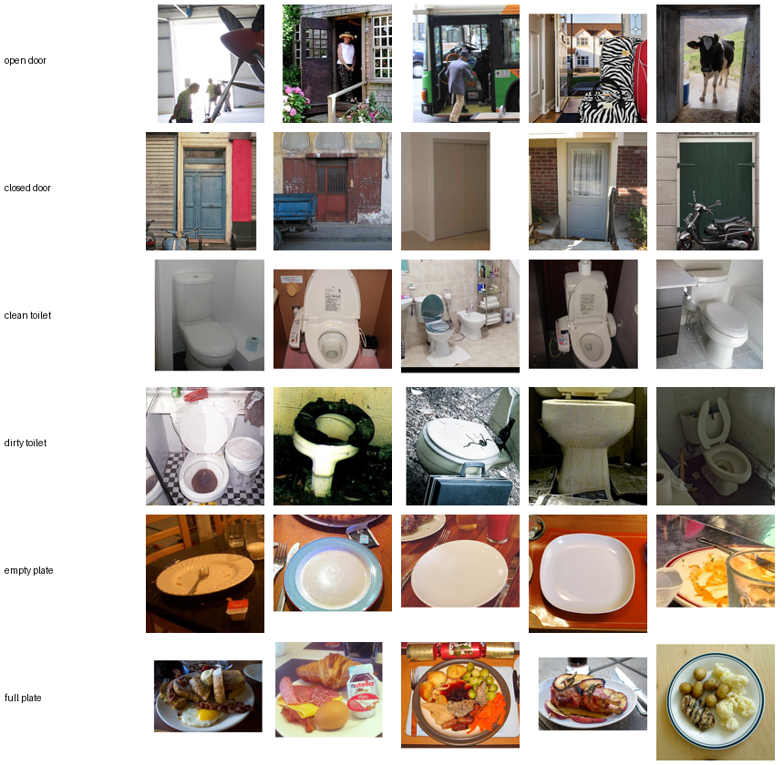
*그림 3. State — 라벨별 사진 5장.*

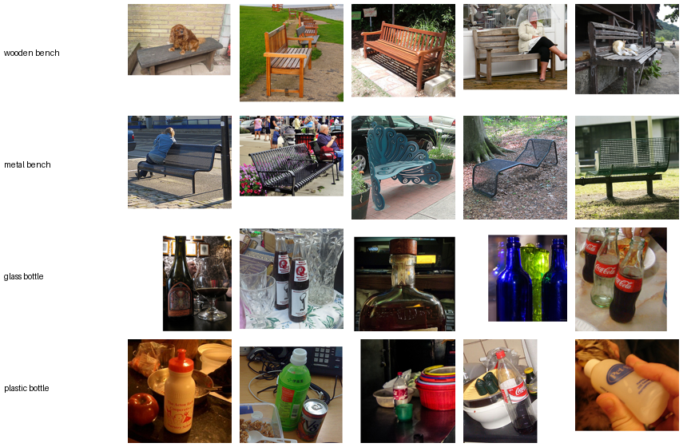
*그림 4. Attribute — 라벨별 사진 5장.*

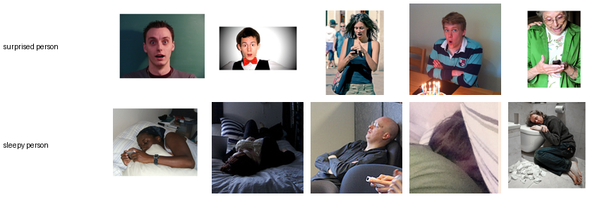
*그림 5. Emotion — 라벨별 사진 5장.*

## 4. 결과: 본 실험 (실제 사진)

### 4.1 행동 결과

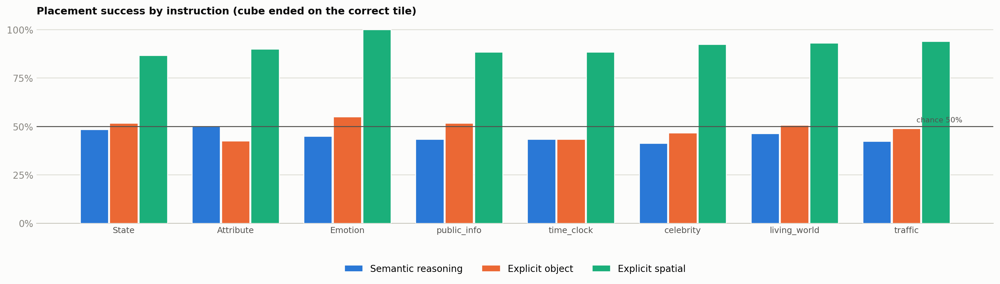
*그림 6. 조건별 placement success (본 실험 3개 세트 + 팀원 5개 카테고리). 가로선은 chance(50%).*

**표 2. Placement success** (큐브가 정답 타일 위에 놓인 비율)

| 테스트 | 지식 질문 | 정답 이름 제시 | 위치 제시 |
|---|---|---|---|
| State | 48% (29/60) | 52% (31/60) | 87% (52/60) |
| Attribute | 50% (20/40) | 42% (17/40) | 90% (36/40) |
| Emotion | 45% (9/20) | 55% (11/20) | 100% (20/20) |
| public_info (팀원) | 43% (26/60) | 52% (31/60) | 88% (53/60) |
| time_clock (팀원) | 43% (26/60) | 43% (26/60) | 88% (53/60) |
| celebrity (팀원) | 41% (124/300) | 47% (140/300) | 92% (277/300) |
| living_world (팀원) | 46% (139/300) | 51% (152/300) | 93% (279/300) |
| traffic (팀원) | 42% (127/300) | 49% (147/300) | 94% (282/300) |

세 세트 모두 지식 질문과 정답 이름 제시는 50% 근처, 위치 제시만 높다. 정답 이름을 직접 알려줘도 지식 질문보다 나아지지 않는다 (intent 기준 paired McNemar: State p = 1.0, Attribute p = 0.66, Emotion p = 0.69).

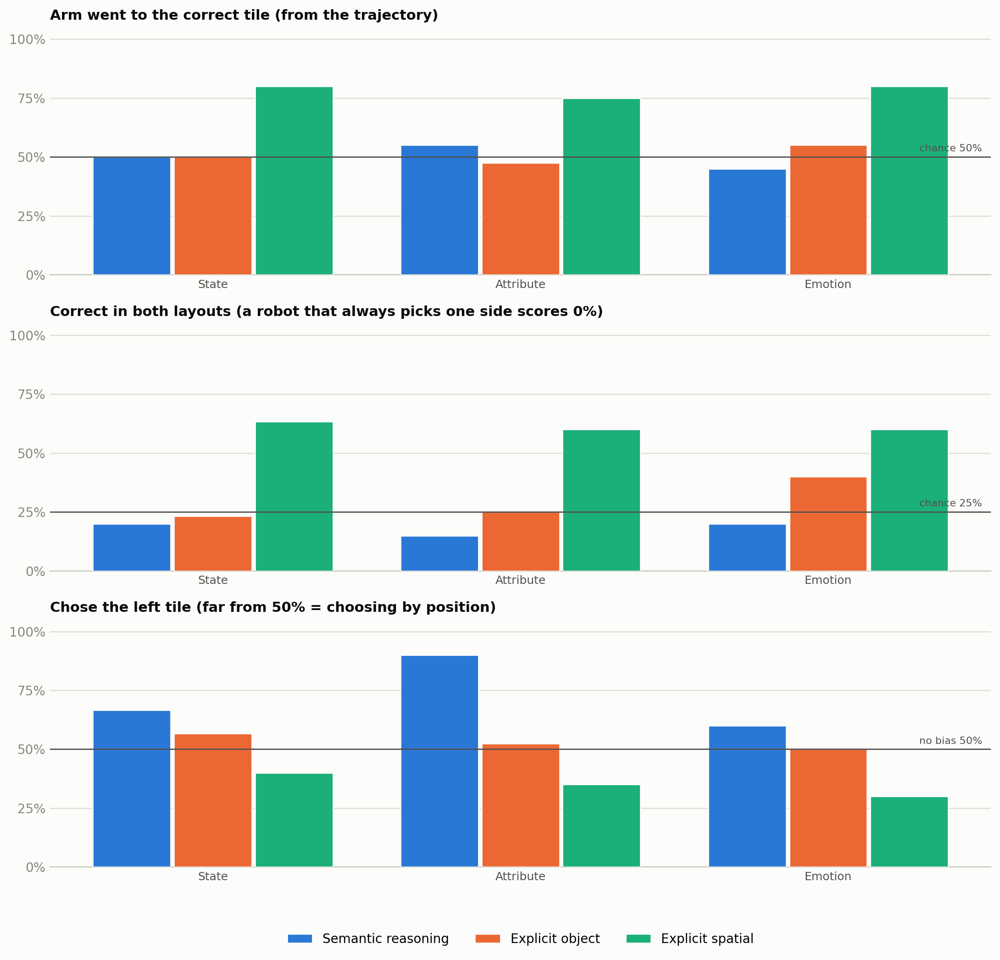
*그림 7. (위) 팔이 정답 타일로 갔는가, (가운데) 양쪽 배치 모두 정답, (아래) 왼쪽 선택 비율.*

**표 3. Intent — 팔이 정답 타일로 갔는가** (궤적 기준)

| 테스트 | 지식 질문 | 정답 이름 제시 | 위치 제시 |
|---|---|---|---|
| State | 50% (30/60) | 50% (30/60) | 80% (48/60) |
| Attribute | 55% (22/40) | 48% (19/40) | 75% (30/40) |
| Emotion | 45% (9/20) | 55% (11/20) | 80% (16/20) |

**표 4. 양쪽 배치 모두 정답** (chance 25%, 한쪽만 고르는 로봇은 0%)

| 테스트 | 지식 질문 | 정답 이름 제시 | 위치 제시 |
|---|---|---|---|
| State | 20% (6/30) | 23% (7/30) | 63% (19/30) |
| Attribute | 15% (3/20) | 25% (5/20) | 60% (12/20) |
| Emotion | 20% (2/10) | 40% (4/10) | 60% (6/10) |

**표 5. 왼쪽 선택 비율** (50%에서 멀수록 위치 편향)

| 테스트 | 지식 질문 | 정답 이름 제시 | 위치 제시 |
|---|---|---|---|
| State | 67% (40/60) | 57% (34/60) | 40% (24/60) |
| Attribute | 90% (36/40) | 52% (21/40) | 35% (14/40) |
| Emotion | 60% (12/20) | 50% (10/20) | 30% (6/20) |

지식 질문에서는 왼쪽 선택이 60~90%로 치우쳐 있고(Attribute 90%), 양쪽 배치를 모두 맞힌 비율은 chance(25%) 근처이거나 그 아래다 (예외: Emotion의 정답 이름 제시 40%, 10문제). 위치 제시에서만 양쪽 배치를 모두 맞히는 비율이 높다 (60~63%).

### 4.2 내부 표현 (probe) 결과

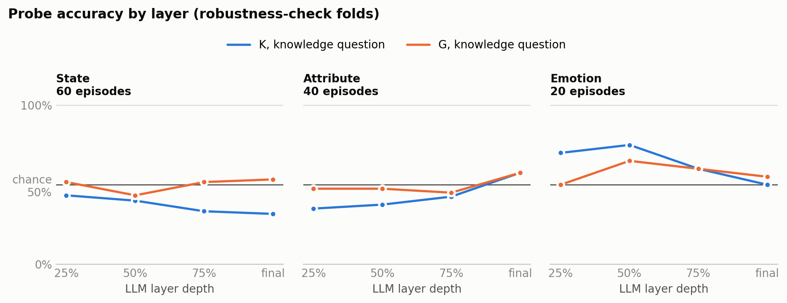
*그림 8. 레이어별 probe 정확도 (robustness check fold). 파랑 = K (지식 질문), 주황 = G (지식 질문). 가로선 = chance(50%).*

**표 6. Probe 정확도 — robustness check fold** (같은 사진 쌍의 질문을 같은 fold에 묶음)

| 테스트 | 레이어 | K (지식 질문) | K vs chance p값 | G (지식 질문) |
|---|---|---|---|---|
| State | 25% | 43% (26/60) | 0.3663 | 52% |
| State | 50% | 40% (24/60) | 0.1550 | 43% |
| State | 75% | 33% (20/60) | 0.0135 | 52% |
| State | final | 32% (19/60) | 0.0062 | 53% |
| Attribute | 25% | 35% (14/40) | 0.0807 | 48% |
| Attribute | 50% | 38% (15/40) | 0.1539 | 48% |
| Attribute | 75% | 42% (17/40) | 0.4296 | 45% |
| Attribute | final | 57% (23/40) | 0.4296 | 57% |
| Emotion | 25% | 70% (14/20) | 0.1153 | 50% |
| Emotion | 50% | 75% (15/20) | 0.0414 | 65% |
| Emotion | 75% | 60% (12/20) | 0.5034 | 60% |
| Emotion | final | 50% (10/20) | 1.0000 | 55% |

State·Attribute에서 K는 모든 레이어에서 chance(50%) 이하이거나 근처다(최대 57%, Attribute 최종 레이어) → K가 표현에 나타나지 않음. 일부 레이어에서 chance보다 유의하게 낮은 값(예: State 최종 레이어 32%)은 정보가 아니라 cross-validation 분할의 artifact다: 같은 사진 쌍이 반대 정답으로 학습 fold에 들어 있어, 장면을 외운 probe가 반대로 답하게 된다. Emotion은 K가 70~75%까지 오르지만 chance와의 차이가 유의하지 않다 (최고 15/20, p = 0.041 > 0.0125; 조건당 20 에피소드로 검정력 부족). G는 세 세트 모두 chance 근처.

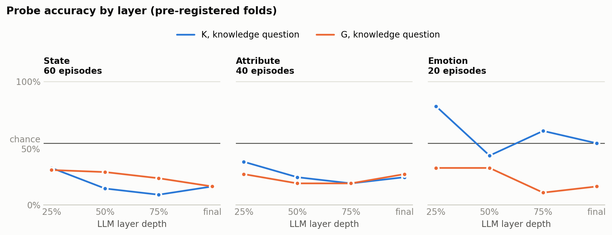
*그림 9. 사전 등록 fold 결과. 이 fold 방식에서는 테스트 질문과 같은 사진 쌍이 반대 정답으로 학습에 들어가 장면 정보가 probe를 chance 아래로 밀어낸다 (State·Attribute의 낮은 값). Emotion은 25% 레이어에서 80% (16/20, p = 0.0118)로 기준을 겨우 넘어 사전 등록 판정이 GO이지만, 이 artifact를 제거한 robustness check에서는 유지되지 않는다.*

**표 7. Probe 정확도 — 사전 등록 fold**

| 테스트 | 레이어 | K (지식 질문) | K vs chance p값 | G (지식 질문) |
|---|---|---|---|---|
| State | 25% | 30% (18/60) | 0.0027 | 28% |
| State | 50% | 13% (8/60) | <0.0001 | 27% |
| State | 75% | 8% (5/60) | <0.0001 | 22% |
| State | final | 15% (9/60) | <0.0001 | 15% |
| Attribute | 25% | 35% (14/40) | 0.0807 | 25% |
| Attribute | 50% | 22% (9/40) | 0.0007 | 18% |
| Attribute | 75% | 18% (7/40) | <0.0001 | 18% |
| Attribute | final | 22% (9/40) | 0.0007 | 25% |
| Emotion | 25% | 80% (16/20) | 0.0118 | 30% |
| Emotion | 50% | 40% (8/20) | 0.5034 | 30% |
| Emotion | 75% | 60% (12/20) | 0.5034 | 10% |
| Emotion | final | 50% (10/20) | 1.0000 | 15% |

## 5. 결과: 팀원 실험 (public_info, time_clock, celebrity, living_world, traffic)

팀원이 공유한 결과(컴종설 실험1, 2개 파일)를 문제 단위로 옮겨 다시 집계했다. 옮긴 값으로 계산한 요약이 팀원 요약표의 **24칸(카테고리 5 × 과제 3, swap/no swap)과 모두 일치**함을 확인했다. 각 에피소드는 3회 반복. public_info·time_clock은 10문제, celebrity·living_world·traffic은 50문제(문제 2k와 2k+1은 같은 두 타일, 정답이 서로 반대). 지식 질문 예: "Place the cube on the sign associated with a more urgent situation." (public_info), "Place the cube on the singer who released the album 21." (celebrity, Adele vs Angelina Jolie), "Place the cube on the species that is the largest living land animal." (living_world), "Place the cube on the sign that warns that trains may cross the road ahead." (traffic).

**표 8. 팀원 요약** (팀원 표와 같은 형식)

| 카테고리 | 문제 수 | 과제 | swap | no swap | 전체 |
|---|---|---|---|---|---|
| public_info | 10 | 정답 이름 제시 (Explicit object) | 63.3% (19/30) | 40.0% (12/30) | 51.7% (31/60) |
| public_info | 10 | 위치 제시 (Explicit spatial) | 83.3% (25/30) | 93.3% (28/30) | 88.3% (53/60) |
| public_info | 10 | 지식 질문 (Semantic reasoning) | 43.3% (13/30) | 43.3% (13/30) | 43.3% (26/60) |
| time_clock | 10 | 정답 이름 제시 (Explicit object) | 46.7% (14/30) | 40.0% (12/30) | 43.3% (26/60) |
| time_clock | 10 | 위치 제시 (Explicit spatial) | 86.7% (26/30) | 90.0% (27/30) | 88.3% (53/60) |
| time_clock | 10 | 지식 질문 (Semantic reasoning) | 33.3% (10/30) | 53.3% (16/30) | 43.3% (26/60) |
| celebrity | 50 | 정답 이름 제시 (Explicit object) | 40.7% (61/150) | 52.7% (79/150) | 46.7% (140/300) |
| celebrity | 50 | 위치 제시 (Explicit spatial) | 91.3% (137/150) | 93.3% (140/150) | 92.3% (277/300) |
| celebrity | 50 | 지식 질문 (Semantic reasoning) | 45.3% (68/150) | 37.3% (56/150) | 41.3% (124/300) |
| living_world | 50 | 정답 이름 제시 (Explicit object) | 52.7% (79/150) | 48.7% (73/150) | 50.7% (152/300) |
| living_world | 50 | 위치 제시 (Explicit spatial) | 92.0% (138/150) | 94.0% (141/150) | 93.0% (279/300) |
| living_world | 50 | 지식 질문 (Semantic reasoning) | 54.7% (82/150) | 38.0% (57/150) | 46.3% (139/300) |
| traffic | 50 | 정답 이름 제시 (Explicit object) | 53.3% (80/150) | 44.7% (67/150) | 49.0% (147/300) |
| traffic | 50 | 위치 제시 (Explicit spatial) | 94.7% (142/150) | 93.3% (140/150) | 94.0% (282/300) |
| traffic | 50 | 지식 질문 (Semantic reasoning) | 42.7% (64/150) | 42.0% (63/150) | 42.3% (127/300) |

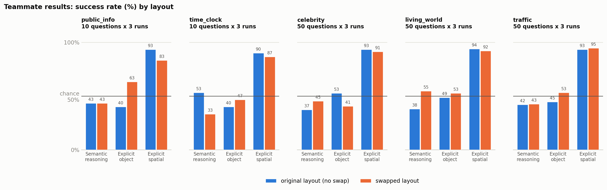
*그림 10. 팀원 결과: 원래 배치(no swap)와 바꾼 배치(swap)의 성공률.*

**표 9. 정답 위치별 성공률 (팀원)** — 정답이 왼쪽/오른쪽에 있을 때

| 카테고리 | 과제 | 정답이 왼쪽일 때 | 정답이 오른쪽일 때 | 차이 (왼−오) |
|---|---|---|---|---|
| public_info | 지식 질문 | 13.3% (4/30) | 73.3% (22/30) | -60%p |
| public_info | 정답 이름 제시 | 40.0% (12/30) | 63.3% (19/30) | -23%p |
| public_info | 위치 제시 | 100.0% (30/30) | 76.7% (23/30) | +23%p |
| time_clock | 지식 질문 | 73.3% (22/30) | 13.3% (4/30) | +60%p |
| time_clock | 정답 이름 제시 | 56.7% (17/30) | 30.0% (9/30) | +27%p |
| time_clock | 위치 제시 | 93.3% (28/30) | 83.3% (25/30) | +10%p |
| celebrity | 지식 질문 | 22.0% (33/150) | 60.7% (91/150) | -39%p |
| celebrity | 정답 이름 제시 | 74.0% (111/150) | 19.3% (29/150) | +55%p |
| celebrity | 위치 제시 | 96.0% (144/150) | 88.7% (133/150) | +7%p |
| living_world | 지식 질문 | 35.3% (53/150) | 57.3% (86/150) | -22%p |
| living_world | 정답 이름 제시 | 54.0% (81/150) | 47.3% (71/150) | +7%p |
| living_world | 위치 제시 | 94.0% (141/150) | 92.0% (138/150) | +2%p |
| traffic | 지식 질문 | 46.0% (69/150) | 38.7% (58/150) | +7%p |
| traffic | 정답 이름 제시 | 58.0% (87/150) | 40.0% (60/150) | +18%p |
| traffic | 위치 제시 | 96.7% (145/150) | 91.3% (137/150) | +5%p |

표 9가 핵심이다. 지식 질문·정답 이름 제시에서 성공률이 정답 위치에 따라 크게 갈린다: public_info 지식 질문 13% ↔ 73% (정답이 오른쪽일 때 높음), time_clock은 반대로 73% ↔ 13%, celebrity는 지식 질문 22% ↔ 61%, 정답 이름 제시 74% ↔ 19%. 즉 로봇은 질문 내용보다 **세트·지시마다 정해진 한쪽**을 주로 고르며, 그 쪽에 정답이 있을 때 "성공"한다. living_world·traffic은 편향이 더 작지만(차이 2~22%p) 전체 성공률은 여전히 chance 수준이다. 위치 제시에서만 양쪽 모두 높다 (77~100%). 본 실험의 왼쪽 선택 편향(표 5)과 같은 현상이다.

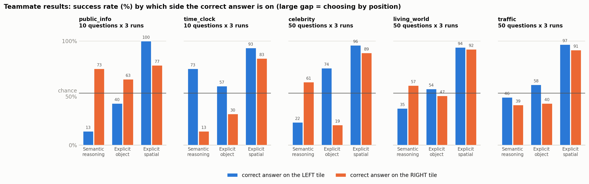
*그림 11. 팀원 결과: 정답이 왼쪽/오른쪽에 있을 때의 성공률.*

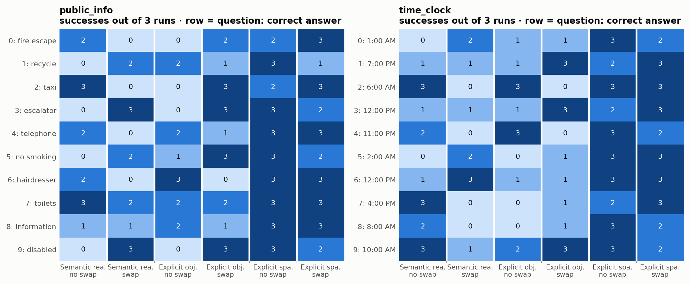
*그림 12. 팀원 결과 (10문제 세트): 문제별 성공 횟수 (3회 중). 행 = 문제 번호: 정답.*

**표 10. 팀원 문제별 결과 — public_info** (50문제 세트의 문제별 결과는 `diagnostics/report/teammate_results.json`) (각 칸: no swap · swap, 3회 중 성공 횟수)

| # | 지식 질문 (… associated with / showing a time when …) | 타일 (no swap: 왼쪽 / 오른쪽) | 정답 | 지식 질문 | 정답 이름 | 위치 |
|---|---|---|---|---|---|---|
| 0 | a more urgent situation | hairdresser / fire escape | fire escape | 2 · 0 | 0 · 2 | 2 · 3 |
| 1 | environmental protection | recycle / no entry | recycle | 0 · 2 | 2 · 1 | 3 · 1 |
| 2 | a service you are more likely to pay for | stairs / taxi | taxi | 3 · 0 | 0 · 3 | 2 · 3 |
| 3 | something that uses electricity | escalator / stairs | escalator | 0 · 3 | 0 · 3 | 3 · 2 |
| 4 | talking to someone | recycle / telephone | telephone | 2 · 0 | 2 · 1 | 3 · 3 |
| 5 | protecting people's health | no smoking / no entry | no smoking | 0 · 2 | 1 · 3 | 3 · 2 |
| 6 | changing someone's appearance | stairs / hairdresser | hairdresser | 2 · 0 | 3 · 0 | 3 · 3 |
| 7 | a bodily need | toilets / no parking | toilets | 3 · 2 | 2 · 2 | 3 · 3 |
| 8 | finding information while sightseeing | no dogs / information | information | 1 · 1 | 2 · 1 | 3 · 3 |
| 9 | a person using a wheelchair | disabled / fire escape | disabled | 0 · 3 | 0 · 3 | 3 · 2 |

**표 11. 팀원 문제별 결과 — time_clock**

| # | 지식 질문 (… associated with / showing a time when …) | 타일 (no swap: 왼쪽 / 오른쪽) | 정답 | 지식 질문 | 정답 이름 | 위치 |
|---|---|---|---|---|---|---|
| 0 | stars are more likely to be visible | 10:00 AM / 1:00 AM | 1:00 AM | 0 · 2 | 1 · 1 | 3 · 2 |
| 1 | closer to sunset | 6:00 AM / 7:00 PM | 7:00 PM | 1 · 1 | 1 · 3 | 2 · 3 |
| 2 | closer to sunrise | 6:00 AM / 7:00 PM | 6:00 AM | 3 · 0 | 3 · 0 | 3 · 3 |
| 3 | outdoor shadows are shorter | 9:00 AM / 12:00 PM | 12:00 PM | 1 · 1 | 1 · 3 | 2 · 3 |
| 4 | streetlights are more likely to be on | 11:00 PM / 2:00 PM | 11:00 PM | 2 · 0 | 3 · 0 | 3 · 2 |
| 5 | you are more likely to need a flashlight outdoors | 1:00 PM / 2:00 AM | 2:00 AM | 0 · 2 | 0 · 1 | 3 · 3 |
| 6 | closer to when the sun is highest | 11:00 PM / 12:00 PM | 12:00 PM | 1 · 3 | 1 · 1 | 3 · 3 |
| 7 | it is typically warmer outdoors | 4:00 PM / 5:00 AM | 4:00 PM | 3 · 0 | 0 · 1 | 2 · 3 |
| 8 | a typical morning commute time | 8:00 AM / 6:00 PM | 8:00 AM | 2 · 0 | 0 · 1 | 3 · 2 |
| 9 | school classes are typically in session | 10:00 AM / 7:00 PM | 10:00 AM | 3 · 1 | 2 · 3 | 3 · 2 |

### 5.1 본 실험과 팀원 실험 비교

| 테스트 | 지식 질문 | 정답 이름 제시 | 위치 제시 |
|---|---|---|---|
| State (사진, 본 실험) | 48% | 52% | 87% |
| Attribute (사진, 본 실험) | 50% | 42% | 90% |
| Emotion (사진, 본 실험) | 45% | 55% | 100% |
| public_info (팀원, 10문제 × 3회) | 43% | 52% | 88% |
| time_clock (팀원, 10문제 × 3회) | 43% | 43% | 88% |
| celebrity (팀원, 50문제 × 3회) | 41% | 47% | 92% |
| living_world (팀원, 50문제 × 3회) | 46% | 51% | 93% |
| traffic (팀원, 50문제 × 3회) | 42% | 49% | 94% |

에셋, 질문, 실행자가 달라도 8개 세트 모두에서 같은 패턴이 재현된다 (지식 질문 41~50%, 정답 이름 제시 42~55%, 위치 제시 87~100%).

## 6. 해석

1. **Motor 문제가 아니다.** 위치 제시 지시는 모든 세트에서 87~100% 성공한다.
2. **정답 이름을 알려줘도 해결되지 않는다.** Explicit object ≈ Semantic reasoning ≈ chance. 로봇은 지시 내용보다 위치(한쪽 타일)로 고르며, 이 편향은 본 실험과 팀원 실험 모두에서 나타난다. 실패는 "지식을 몰라서"보다 앞서, 단어/사진을 화면 속 위치로 연결하는 grounding 단계에서 일어난다.
3. **가설의 전제(K가 표현에 있음)가 실사에서 확인되지 않았다.** State·Attribute에서는 정답이 hidden state에서 선형으로 읽히지 않는다. 따라서 "K → G에서 손실"인지, 그 전에 사진 내용과 질문을 연결하지 못하는 것인지(F1)를 probe로는 구분할 수 없다.
4. Probe 결과는 "선형 분류기로 decode 가능"이라는 뜻이며, 모델이 그 정보를 행동에 *사용*하는지는 보여주지 않는다 (causal tracing 단계의 과제).

## 7. 한계 및 실행 중 수정한 문제

| 구분 | 내용 |
|---|---|
| 에셋 | 공식 Act2Answer 에셋이 아닌 공개 사진(Visual Genome)으로 구성한 세트. 장면 사진을 잘라낸 것이라 배경이 섞임 |
| 규모 | 본 실험은 seed 1개, 에피소드 1회 실행 (팀원은 3회). Emotion은 라벨 쌍 1개, 조건당 20 에피소드로 검정력 부족 |
| 질문 | 본 실험 질문은 Claude가 작성한 초안, 팀 검토 전 (`diagnostics/dataset_build/photo_output/*_questions.csv`) |
| 팀원 데이터 | 공유받은 PDF 2개에서 옮겨 적은 값 (요약표 24칸과 일치 확인). 팀원 실험은 probe(hidden state)가 없어 행동 결과만 비교 가능 |
| 수정 1 | 첫 사진 빌드에서 "sad person"에 개·고양이, "open door"에 냉장고가 섞임 → 물체 확인 단계 추가 + 육안 검토 6장 제외 후 재실행 |
| 수정 2 | K probe가 두 타일에 같은 점수를 줄 때 둘 다 오답 처리하던 버그 → 동점은 chance로 처리 |
| 수정 3 | 사전 등록 fold에서 장면 정보가 probe를 chance 아래로 밀어내는 분할 artifact 발견 → robustness check (같은 사진 쌍끼리 같은 fold) 추가 |
| 판정 기준 | 판정 기준 1의 비교 대상을 chance(50%, 이항 검정)로 제시함. 실행 전 기준과 판정 결과는 동일 |

## 8. 다음 단계 제안

1. **위치 편향 정량화:** 팀원 세트와 본 세트 모두에서 정답 위치별 성공률을 기본 지표로 보고 (표 9 형식). celebrity처럼 지시 종류에 따라 편향 방향이 바뀌는 이유도 확인.
2. **텍스트 전용 대조 실험:** 이미지 없이 질문만으로 K가 decode되는지 확인 → K가 언어 단계에서부터 없는지 구분.
3. **Emotion 재실행:** 얼굴 데이터셋(예: CEED)으로 라벨 쌍과 문제 수를 늘려 검정력 확보.
4. **질문 검토와 반복 확대:** 팀 검토 후 seed 2~3개(팀원처럼 3회 반복)로 재실행.
5. 공식 Act2Answer 에셋이 공개되면 동일 파이프라인으로 재현. K→G 병목이 확인되는 세트에 한해 activation patching (causal tracing).

## 9. 재현 방법 및 파일 위치

```bash
# 사진 세트 생성 + 평가 + 분석을 한 번에 (Slurm, 자동 연결)
sbatch slurm/photo_build.sbatch
# 표 / 그림 / 보고서
python -m diagnostics.export_results_table          # outputs/results_raw.xlsx (팀원 형식)
python -m diagnostics.plot_results --assets photo_state_v1 photo_attribute_v1 photo_emotion_v1 --out-dir diagnostics/report/figures
python diagnostics/report/plot_teammate.py          # 팀원 결과 그림
python diagnostics/report/build_pdf.py --fonts ~/YeahPick/data/fonts
```

| 내용 | 위치 |
|---|---|
| 설계·판정 기준·결과 기록 | `diagnostics/HYPOTHESIS_PILOT.md` |
| 전체 분석 표 | `outputs/photo_hypothesis/<세트>/<fold>/report.md` |
| 에피소드별 결과 (엑셀) | `outputs/results_raw.xlsx` |
| 팀원 결과 (옮겨 적은 원본) | `diagnostics/report/teammate_results.json` |
| 실행 영상 | `outputs/openvla-photo_<세트>-<조건>-<배치>-q…-seed0/glob/vis_0_test/*.mp4` |
| 사진 출처·라이선스 | `diagnostics/dataset_build/photo_output/<세트>_credits.csv` |
