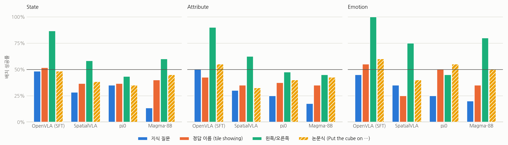
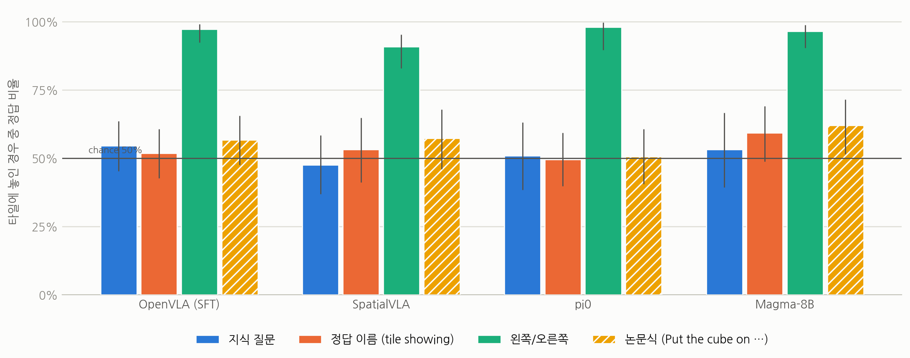
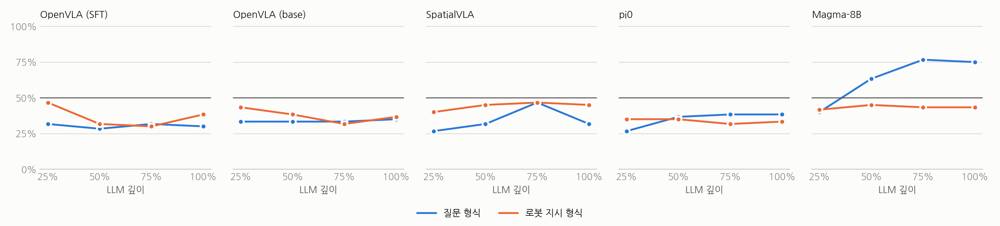

# 여러 VLA 모델 비교: K → G → A 가설 검증 결과 보고서

**프로젝트:** 예픽 — Tracing World Knowledge into Embodied Action in VLA Models
**모델:** OpenVLA (SFT / base), SpatialVLA, pi0, Magma-8B · **환경:** SimplerEnv / ManiSkill (Act2Answer 프로토콜)
**작성일:** 2026-10-07 · **실험:** 실제 사진 타일 3개 세트 (State 30문제, Attribute 20문제, Emotion 10문제) × 지시 조건 4개 × 좌우 배치 2개

---

## 요약

- **실험 셋업은 논문과 맞다.** 논문과 같은 형식의 색상 과제("Put cube on blue")에서 OpenVLA (SFT), SpatialVLA, pi0, Magma 모두 83~100%로, 논문 수치(82~89%)를 재현했다. OpenVLA (base)만 58%로 논문(89%)보다 낮아 결론에서 제외했다.
- **지식 질문에서는 모든 모델이 우연 수준이다.** 큐브를 타일 위에 놓은 경우만 세어도 정답 비율은 48~55%로 50%와 차이가 없다. "왼쪽/오른쪽" 지시에서는 모든 모델이 91~98%로 정확하다.
- **Magma는 지식을 갖고 있지만 행동으로 이어지지 않는다.** 이미지 없이 질문만 주면 Magma의 언어 모델은 정답을 73% 맞히고 (p = 0.0004), 내부 표현에서도 정답이 읽힌다 (75% 깊이에서 77%). 논문식으로 정답 이름을 직접 주면 62%로 우연보다 높다 (p = 0.03). 그러나 같은 정답을 질문으로 물으면 53%로 우연 수준이다.
- **결론:** Magma에서는 K(지식)도 있고, 이름이 주어진 타일을 찾아가는 능력도 있지만, **질문 → 정답 → 행동으로 이어지는 연결이 끊어진다.** 연구제안서가 다루는 지점과 일치한다. 나머지 모델은 이미지 없이도 질문에 답하지 못하므로(우연 수준), 지식 단계에서 이미 실패한다.

**표 1. 모델별 핵심 결과 (세 세트 합계)**

| 모델 | 색상 확인 (논문) | 텍스트만: 정답률 | 지식 질문: 타일 위 정답 | 논문식 지시: 타일 위 정답 | 왼쪽/오른쪽: 타일 위 정답 |
|---|---|---|---|---|---|
| OpenVLA (SFT) | 83% (82%) | 50% | 55% (60/110) | 57% (63/111) | 97% |
| SpatialVLA | 92% (87%) | 43% | 48% (38/80) | 57% (43/75) | 91% |
| pi0 | 100% (86%) | 50% | 51% (30/59) | 51% (46/91) | 98% |
| **Magma-8B** | 83% (89%) | **73%** | 53% (25/47) | **62% (54/87)** | 97% |

---

## 1. 무엇을 검증했나

연구제안서의 가설은 다음과 같다.

> VLA 내부에 올바른 world-knowledge answer(**K**)가 있더라도, 이를 visual scene의 physical target(**G**)으로 grounding하고 행동(**A**)으로 옮기는 과정에서 정보가 손실된다.

이전 보고서는 OpenVLA 한 모델만 다뤘다. 그 결과 OpenVLA에서는 K 자체가 읽히지 않아 가설을 검증할 수 없었다. 이번에는 Act2Answer 논문처럼 **여러 모델**을 같은 과제로 비교했다. 특히 논문에서 지식을 가장 잘 유지한 Magma가 핵심이다.

### 1.1 지시 조건

탁자 위에 사진 타일 두 장이 있고, 로봇은 큐브를 정답 타일 위에 놓아야 한다. 같은 문제를 네 가지 지시로 실행했다.

| 조건 | 지시문 예시 | 필요한 단계 |
|---|---|---|
| 지식 질문 | Place the cube on the answer to this question: Which door could a person walk straight through? | 질문 → 정답(열린 문) → 타일 찾기 → 행동 |
| 논문식 지시 (신규) | Put the cube on the open door. | 타일 찾기 → 행동 |
| 정답 이름 | Place the cube on the tile showing the open door. | 타일 찾기 → 행동 |
| 왼쪽/오른쪽 | Place the cube on the left tile. | 행동만 |

**논문식 지시**는 이번에 새로 추가했다. 논문(부록 B.4)의 VLA 지시는 "Put the cube on dryer grass"처럼 **정답 대상을 직접 말하는** 형식이다. 즉 논문의 Emotion/Attribute/State 수치는 우리의 "지식 질문"이 아니라 이 조건과 비교해야 한다.

### 1.2 모델

| 모델 | 체크포인트 | 비고 |
|---|---|---|
| OpenVLA (SFT) | gen-robot/openvla-7b-rlvla-sft_16k | 이전 보고서의 모델, 논문 기본값 |
| OpenVLA (base) | openvla/openvla-7b | 색상 확인 실패로 결론에서 제외 |
| SpatialVLA | IPEC-COMMUNITY/spatialvla-4b-224-pt | 논문과 같은 체크포인트 |
| pi0 | juexzz/INTACT-pi0-finetune-bridge | 논문과 같은 체크포인트, 연결 코드는 직접 재구성 |
| Magma-8B | microsoft/Magma-8B | 논문과 같은 체크포인트 |

### 1.3 측정 방법

- **배치 성공률:** 큐브가 정답 타일 위에 놓였는가 (환경의 기본 판정).
- **타일 위 정답 비율:** 큐브가 두 타일 중 하나에서 15 cm 이내에 놓인 에피소드만 세고, 그중 정답 타일 비율을 본다. 여러 모델이 긴 지시문에서 큐브를 아무 타일에도 놓지 못하는 경우가 많아서, **"어느 쪽을 골랐는가"**는 이 값이 더 정확하다.
- **텍스트만 테스트:** 이미지 없이 질문만 모델 내부의 언어 모델에 넣는다. (1) 정답 단어와 오답 단어 중 어느 쪽 확률이 높은지, (2) hidden state에서 선형 probe로 정답을 읽을 수 있는지 본다.

---

## 2. 셋업 확인: 색상 과제

먼저 우리 셋업이 논문과 같은지 확인했다. 논문의 가장 쉬운 범주인 색상 과제를 논문 형식("Put cube on blue")으로 실행했다 (6문제 × 좌우 2배치 = 12 에피소드).

**표 2. 색상 과제 성공률**

| 모델 | 우리 결과 | 논문 (Table 2) |
|---|---|---|
| OpenVLA (SFT) | 83% (10/12) | 82% |
| OpenVLA (base) | 58% (7/12) | 89% |
| SpatialVLA | 92% (11/12) | 87% |
| pi0 | 100% (12/12) | 86% |
| Magma-8B | 83% (10/12) | 89% |

네 모델은 논문 수치와 비슷하다. **OpenVLA (base)만 크게 낮아**, 이 모델의 설정(행동 정규화 등)이 논문과 다를 가능성이 높다. 이후 결론에서는 제외한다.

---

## 3. 행동 결과

### 3.1 배치 성공률


*그림 1. 세트별 배치 성공률. 검은 선은 우연 수준(50%). 빗금 막대는 논문식 지시.*

**표 3. 배치 성공률 (성공 / 에피소드)**

| 모델 | 세트 | 지식 질문 | 논문식 지시 | 정답 이름 | 왼쪽/오른쪽 |
|---|---|---|---|---|---|
| OpenVLA (SFT) | State | 48% (29/60) | 48% (29/60) | 52% (31/60) | 87% (52/60) |
| OpenVLA (SFT) | Attribute | 50% (20/40) | 55% (22/40) | 43% (17/40) | 90% (36/40) |
| OpenVLA (SFT) | Emotion | 45% (9/20) | 60% (12/20) | 55% (11/20) | 100% (20/20) |
| SpatialVLA | State | 28% (17/60) | 38% (23/60) | 37% (22/60) | 58% (35/60) |
| SpatialVLA | Attribute | 30% (12/40) | 33% (13/40) | 35% (14/40) | 63% (25/40) |
| SpatialVLA | Emotion | 35% (7/20) | 40% (8/20) | 25% (5/20) | 75% (15/20) |
| pi0 | State | 35% (21/60) | 35% (21/60) | 37% (22/60) | 43% (26/60) |
| pi0 | Attribute | 25% (10/40) | 40% (16/40) | 38% (15/40) | 48% (19/40) |
| pi0 | Emotion | 25% (5/20) | 55% (11/20) | 50% (10/20) | 45% (9/20) |
| Magma-8B | State | 13% (8/60) | 45% (27/60) | 40% (24/60) | 60% (36/60) |
| Magma-8B | Attribute | 18% (7/40) | 43% (17/40) | 35% (14/40) | 45% (18/40) |
| Magma-8B | Emotion | 20% (4/20) | 50% (10/20) | 35% (7/20) | 80% (16/20) |

배치 성공률이 50%보다 낮은 칸이 많다. 이는 **잘못된 타일을 골라서가 아니라, 큐브를 어느 타일에도 놓지 못해서**인 경우가 대부분이다. 특히 긴 지식 질문에서 그렇다. Magma는 지식 질문에서 큐브를 타일 위에 놓은 비율이 39%에 그치지만, 논문식 지시에서는 72%다.

### 3.2 타일 위에 놓은 경우의 정답 비율


*그림 2. 큐브를 타일 위에 놓은 에피소드 중 정답 타일 비율 (세 세트 합계). 오차 막대는 95% Wilson 신뢰구간.*

**표 4. 타일 위 정답 비율 (정답 / 타일 위에 놓은 수, 괄호는 우연 대비 p값)**

| 모델 | 지식 질문 | 논문식 지시 | 정답 이름 | 왼쪽/오른쪽 |
|---|---|---|---|---|
| OpenVLA (SFT) | 55% (60/110, p=0.39) | 57% (63/111, p=0.18) | 52% (59/114, p=0.78) | 97% (109/112) |
| SpatialVLA | 48% (38/80, p=0.74) | 57% (43/75, p=0.25) | 53% (34/64, p=0.71) | 91% (79/87) |
| pi0 | 51% (30/59, p=1.00) | 51% (46/91, p=1.00) | 49% (48/97, p=1.00) | 98% (50/51) |
| **Magma-8B** | 53% (25/47, p=0.77) | **62% (54/87, p=0.03)** | 59% (51/86, p=0.11) | 97% (84/87) |

- **왼쪽/오른쪽 지시는 모든 모델이 정확히 따른다 (91~98%).** 따라서 지식 질문의 실패는 동작 제어 문제가 아니다.
- **지식 질문에서는 모든 모델이 우연 수준이다.**
- **우연보다 유의하게 높은 경우는 Magma의 논문식 지시 하나뿐이다 (62%).** 이는 논문에서 Magma만 의미 범주에서 우연보다 높았던 결과와 같다.

**표 5. Magma: 세트별 비교 (타일 위 정답 비율)**

| 세트 | 지식 질문 | 논문식 지시 | 논문 (Table 2) |
|---|---|---|---|
| State | 45% (10/22) | 57% (25/44) | 59% |
| Attribute | 50% (7/14) | 64% (18/28) | 63% |
| Emotion | 73% (8/11) | 73% (11/15) | 72% |

논문식 지시에서 Magma의 세트별 수치는 논문과 거의 같다. 다만 세트별 표본이 작아(11~44개) 개별 세트 차이는 유의하지 않으며, 세 세트를 합친 62%만 유의하다.

---

## 4. 텍스트만 테스트: 언어 모델에 지식이 있는가

이미지와 로봇 과제를 빼고, 질문만 각 VLA 내부의 언어 모델에 넣었다. 지식 자체가 남아 있는지 확인하기 위해서다.

**표 6. 정답 단어 vs 오답 단어 확률 비교 (우연 50%)**

| 모델 | 정답률 (60문제) | 일반 상식 확인 (5문제) |
|---|---|---|
| OpenVLA (SFT) | 50% (30/60) | 2/5 |
| OpenVLA (base) | 53% (32/60) | 2/5 |
| SpatialVLA | 43% (26/60) | 3/5 |
| pi0 | 50% (30/60) | 4/5 |
| **Magma-8B** | **73% (44/60), p = 0.0004** | 4/5 |

Magma는 세트별로 State 73% (22/30), Attribute 65% (13/20), Emotion 90% (9/10)이다. **다섯 모델 중 Magma만 언어 모델에 이 지식이 남아 있다.** OpenVLA는 base 모델도 우연 수준이므로, 지식 손실은 로봇 fine-tuning(SFT) 이전부터 있었다.


*그림 3. 텍스트만 probe: 언어 모델 깊이별로 hidden state에서 정답을 읽은 정확도. 파란 선은 질문 형식("Question: … Answer:"), 주황 선은 로봇 지시 형식("What action should the robot take to …").*

**표 7. 텍스트만 probe 정확도 (60문제, 우연 50%)**

| 모델 | 형식 | 25% | 50% | 75% | 100% |
|---|---|---|---|---|---|
| OpenVLA (SFT) | 질문 | 32% | 28% | 32% | 30% |
| OpenVLA (SFT) | 로봇 지시 | 47% | 32% | 30% | 38% |
| OpenVLA (base) | 질문 | 33% | 33% | 33% | 35% |
| OpenVLA (base) | 로봇 지시 | 43% | 38% | 32% | 37% |
| SpatialVLA | 질문 | 27% | 32% | 47% | 32% |
| SpatialVLA | 로봇 지시 | 40% | 45% | 47% | 45% |
| pi0 | 질문 | 27% | 37% | 38% | 38% |
| pi0 | 로봇 지시 | 35% | 35% | 32% | 33% |
| **Magma-8B** | **질문** | 40% | 63% | **77%** | **75%** |
| Magma-8B | 로봇 지시 | 42% | 45% | 43% | 43% |

- **Magma는 질문 형식에서 중간~후반 층에 정답이 뚜렷하게 담긴다** (75% 깊이 77%, p < 0.0001).
- **같은 질문을 로봇 지시 형식으로 감싸면 Magma에서도 우연 수준(42~45%)으로 떨어진다.** 로봇 모드에서는 지식이 행동 쪽으로 전달되지 않는다는 행동 결과와 일치한다.
- **우연보다 낮은 값(27~38%)은 지식이 없다는 뜻이며, 반대 지식을 뜻하지 않는다.** probe는 질문 문장 하나를 빼고 학습한다. 신호가 없을 때 이 방식은 정확도를 우연보다 아래로 끌어내린다 (이전 사진 실험에서도 같은 현상을 확인했다).

---

## 5. 해석: K → G → A에서 어디가 끊기는가

**표 8. 단계별 정리**

| 단계 | OpenVLA (SFT) | SpatialVLA | pi0 | Magma-8B |
|---|---|---|---|---|
| K: 질문만으로 정답을 아는가 (텍스트만) | 아니오 (50%) | 아니오 (43%) | 아니오 (50%) | **예 (73%)** |
| G+A: 이름이 주어진 타일을 찾아 놓는가 (논문식) | 아니오 (57%, n.s.) | 아니오 (57%, n.s.) | 아니오 (51%) | **예 (62%)** |
| A: 왼쪽/오른쪽 지시를 따르는가 | 예 (97%) | 예 (91%) | 예 (98%) | 예 (97%) |
| K → A: 질문을 받고 정답 타일로 가는가 | 아니오 (55%) | 아니오 (48%) | 아니오 (51%) | **아니오 (53%)** |

- **OpenVLA, SpatialVLA, pi0:** 언어 모델에 지식이 없다. 따라서 이 모델들에서는 "K가 있는데 G에서 손실된다"는 가설을 검증할 수 없다. 실패는 K 단계에서 이미 일어난다.
- **Magma:** 각 단계는 따로따로 작동한다. 질문에 답할 수 있고(K), 이름이 주어진 타일을 찾아갈 수 있고(G+A), 왼쪽/오른쪽을 따른다(A). 그러나 **질문을 받으면 정답 타일로 가지 못한다.** 또한 로봇 지시 형식에서는 hidden state에서도 정답이 사라진다.
- 따라서 Magma에서는 **지식이 있지만, 질문이 로봇 지시 형식으로 주어지는 순간 정답이 행동 경로로 전달되지 않는다.** 연구제안서의 가설("K가 있어도 행동으로 가는 과정에서 손실된다")을 지지하는 첫 근거다.

---

## 6. 한계

- **표본이 작다.** 세트별 칸은 20~60 에피소드, 타일 위에 놓은 수는 11~114개다. 유의한 결과는 Magma의 텍스트만 정답률(73%), 텍스트 probe(77%), 논문식 지시 합계(62%)다.
- **Magma의 이미지 포함 probe가 없다.** 로봇 실행 중 hidden state 저장은 OpenVLA에만 구현되어 있다. "로봇 실행 중 Magma 내부에서 정답이 언제 사라지는가"는 아직 직접 확인하지 못했다. 텍스트만 probe의 로봇 지시 형식 결과가 간접 근거다.
- **배치 실패가 많다.** 긴 질문형 지시에서 여러 모델이 큐브를 어느 타일에도 놓지 못한다 (Magma 지식 질문 61%). 정답 선택은 "타일 위에 놓은 경우"로 따로 측정했지만, 그만큼 표본이 줄어든다.
- **pi0 연결 코드는 직접 재구성했다.** 저자 코드가 공개되지 않아 INT-ACT 코드와 lerobot fork로 다시 연결했다. 색상 과제에서 100%로 정상 작동은 확인했다.
- **OpenVLA (base)는 셋업이 논문과 다르다** (색상 58% vs 89%). 텍스트만 테스트 결과(언어 모델에 지식 없음)는 셋업과 무관하므로 그대로 유효하다.
- **이미지가 논문과 다르다.** 우리는 Visual Genome 사진, 논문은 MLLM-CompBench 이미지를 쓴다. 정답 이름도 우리 데이터셋 기준이다 (예: surprised/sleepy person).
- **시드는 하나(seed 0)다.** Magma는 행동 생성 시 샘플링(temperature 0.7)을 사용한다.

---

## 7. 다음 단계

1. **Magma 이미지 포함 probe:** 로봇 실행 중 Magma의 hidden state(25/50/75/100% 깊이)를 저장해, 지식 질문과 논문식 지시에서 정답(K)이 읽히는지 비교한다. K→A 단절이 어디서 일어나는지 직접 보는 핵심 실험이다.
2. **표본 확대:** Magma의 논문식/지식 질문 조건을 시드를 늘려 반복해, 세트별 차이를 유의하게 만든다.
3. **OpenVLA (base) 셋업 수정:** 색상 과제가 논문 수치(89%)에 맞을 때까지 설정을 맞춘다.

---

## 부록 A. 재현 방법

모든 명령은 저장소 루트(`Act2Answer/`)에서 실행한다.

```
# 모델별 실행 (예: Magma, State 세트, 4개 조건)
sbatch --array=0-23 --export=ALL,VLA=magma,ASSETS=photo_state_v1,\
  CONDITIONS="knowledge paper_style tile_object explicit_spatial" slurm/run_vla.sbatch

# 텍스트만 테스트
sbatch --export=ALL,MODEL=magma slurm/text_only_knowledge.sbatch

# 비교 표와 그림
python -m diagnostics.compare_models --models openvla spatialvla pi0 magma
python diagnostics/report/plot_models.py
python diagnostics/report/build_pdf.py --md diagnostics/report/REPORT_models_ko.md \
  --out diagnostics/report/REPORT_models_ko.pdf --fonts ~/YeahPick/data/fonts
```

**구현상 주요 변경점**

- `scripts/eval_vla.sh`, `slurm/run_vla.sbatch`: 모든 모델 공통 실행 스크립트.
- `paper_style` 지시 조건 추가 ("Put the cube on the {정답}.").
- pi0: INT-ACT 코드와 lerobot fork를 `pi0_deps`로 구성. 환경마다 매 단계 새 행동 묶음(chunk)을 예측하고 첫 행동을 실행.
- Magma: 지시문 길이가 달라 배치 처리가 불가능하므로 환경을 하나씩 처리.
- 버전 고정: setuptools<70, transformers 4.48.3 (pi0), open_clip_torch (Magma).
