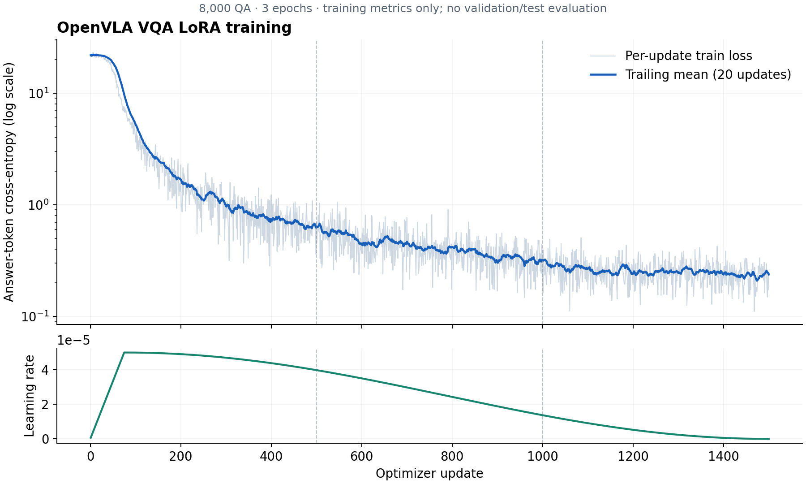

# OpenVLA VQA 파인튜닝 실험 보고서

보고서 작성일: 2026-11-11 (KST)

## 목적과 범위

공식 OpenVLA의 semantic reasoning 관련 표현을 VQA 텍스트 지도학습으로
적응시키는 첫 실험이다. 로봇 행동 개선은 후속 평가 가설이며, 이번 학습으로
입증한 결과가 아니다. 사용자 요청에 따라 전체 데이터를 학습에 사용했고
검증·테스트 분할, VQA 정답률 측정, 로봇 행동 평가는 수행하지 않았다.

## 모델과 환경

- Base: `openvla/openvla-7b`
- Base revision: `47a0ec7fc4ec123775a391911046cf33cf9ed83f`
- VESSL: CS-LEC-05 / hyerin-vulkan-50g, yonsei-ai-gpu, ai-gpu-07
- GPU: RTX 3090 24GiB × 2, DDP
- 정밀도: BF16 frozen base/compute; FP32 adapters/optimizer; not quantized
- 정확한 패키지 버전: `environment.txt`

## 데이터

1,600개 VQA 묶음에서 질문 다섯 개씩을 펼쳐 8,000개 QA를
사용했다. 각 epoch에 모든 QA를 정확히 한 번씩 사용했다. 총 학습 노출 횟수는
24,000회다. 합계 800개 좌우 이미지 쌍을 사용했다.

| 카테고리 | QA 수 |
|---|---:|
| attribute | 1000 |
| emotion | 1000 |
| state | 1000 |
| counting | 1000 |
| symmetry | 1000 |
| celebrity | 1000 |
| living_world | 1000 |
| traffic | 1000 |

Object recognition, Attribute recognition, Semantic reasoning, Visual grounding,
Counterfactual grounding은 각각 1,600개다. 카테고리·유형에 추가 가중치를 주지 않았다.
원본 branch/commit/file/해시는 `data_audit.json`에 기록했다. jaeho의 통합 JSONL과
카테고리 JSONL은 같은 QA이므로 카테고리 파일만 읽었다. 원본 질문 풀과 pair
metadata는 추가 학습 레코드로 세지 않았다. 이미지가 없는 KDEF는 사용자 승인으로
제외했다. 나머지 8개 카테고리에서는 샘플을 제외하거나 새 정답을 만들지 않았다.

입력은 좌우 두 타일을 고정 순서로 배치한 224×224 RGB 이미지다. 각 타일은
112×224 영역 안에 종횡비를 유지해 배치하고 빈 공간을 흰색으로 채웠다.
정답·labels·knowledge·카테고리 정보는 질문 프롬프트에 추가하지 않았다. 학습에서는
표준 teacher forcing으로 정답 토큰을 뒤에 붙이고 정답·EOS에만 loss를 계산했다.
이미지 증강 및 텍스트 잘림은 적용하지 않았다. 이 작은 해상도는 세부 시각 정보의
제약이 될 수 있다.

Train manifest SHA-256: `c6d4608f50e2c6ca05c52e0bf912d5c75a5a9077e54789c210440640b3457288`

## 학습 방법

- LoRA: LLM attention q_proj/v_proj, rank 16, alpha 32, dropout 0.05
- 학습 파라미터: 8,388,608개
- Vision encoder, projector, embedding, LM head 동결
- 정답 텍스트와 EOS에만 cross-entropy, 질문·시각 토큰·padding은 -100 마스킹
- AdamW, LR 5e-05, weight decay 0.01, gradient clipping 1.0
- Cosine LR schedule, 전체 update의 5% warmup
- Per-GPU batch 8, accumulation 1, effective batch 16
- 3 epoch, 1,500 optimizer updates, seed 42
- LLM gradient checkpointing, SDPA attention, BF16; 4bit 양자화 사용 안 함

짧은 별도 smoke 실행으로 loss/gradient의 유한성과 학습 가능 여부를 확인한 뒤,
본 학습은 원본 모델에서 새로 시작했다. Smoke 실행 결과는 본 학습 지표에 섞지 않았다.

## 실제 학습 결과

- 완료 상태: `completed`
- 첫 10 update 평균 train loss: 21.896689
- 마지막 10 update 평균 train loss: 0.220127
- 전체 평균 train loss: 1.522155
- 기록된 rank-0 최대 GPU allocated memory: 16.120 GiB
- 학습 루프·epoch 저장 소요 시간: 55.95분

| Epoch | 평균 train loss |
|---|---:|
| 1 | 3.894517 |
| 2 | 0.419112 |
| 3 | 0.252837 |

지표는 batch 내 정답 토큰 평균 loss를 gradient accumulation과 GPU에 대해 평균낸
학습 지표다. 검증 점수나 일반화 성능이 아니다. 검증 데이터를 사용하지 않았으므로
최종 3 epoch 모델을 저장했으며, best checkpoint라고 부르지 않는다.

## 산출물과 후속 사용

GitHub의 `hyerin` 브랜치 `vqa_finetuning/`에는 코드, 원본 모델 revision,
데이터 audit와 이미지 hash manifest, 설정, 패키지 목록, 학습 지표 및 본 보고서를
저장한다. Weight와 optimizer 상태는 GitHub에 올리지 않는다.

로컬 `outputs/vqa_finetuning/weights/`에 최종 학습 weight를 보관한다. 실제 전달
파일과 해시는 `weight_manifest.json`에 기록한다. LoRA adapter는 지정된 원본
모델과 revision을 함께 사용해야 한다. `export_merged.py`로 adapter를 원본에
merge하여 BF16 전체 모델을 재현할 수 있다. 전체 모델은 원본 action normalization
설정을 유지한다. 학습에서 action loss를
사용하지 않았으므로 이후 행동 평가에서 기존 제어 능력 유지 여부와 의미 지시
성공률을 모두 확인해야 한다. 학습에 사용한 이미지/질문과의 중복 여부도 후속
평가 설계에서 구분해야 한다.

## 학습 곡선 및 후속 평가 설정

공식 원본과 기존 rlvla 모델의 차이, `UNNORM=sft` 호환성 및 생성 라이브러리
버전 관련 사항은 [후속 평가 참고](evaluation_notes.md)에 기록했다.
